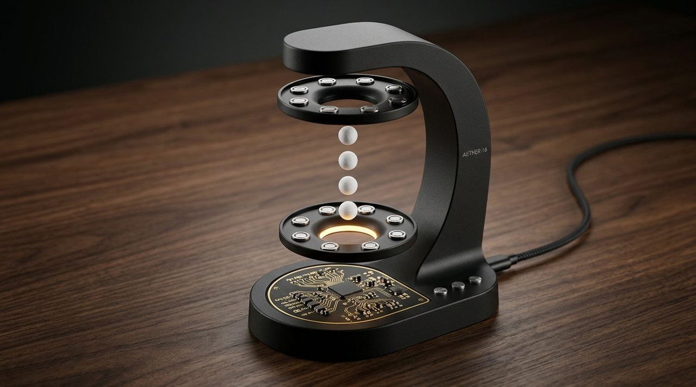

   

# AETHER-16 — Pure-Silicon 16-Channel Acoustic Levitator ASIC (`gf180mcuD`, `1×1`)

**AETHER-16** (`tt_um_ayushmanmalla_top`) is a `1×1` Tiny Tapeout custom ASIC (`gf180mcuD`, 180 nm, `50 MHz`) that drives **16 simultaneous, phase-locked, glitch-free 40 kHz ultrasonic channels** at **7-bit (128-step, `2.8125°` / `34 µm`) phase resolution** to suspend and smoothly animate real 1–3 mm objects in mid-air—completely microcontroller-free in Standalone Kinetic Art Mode, or fully programmable via SPI Mode 0.

## Key Documentation
- **[Tiny Tapeout Datasheet](docs/info.md)** — Pinout, operation, Day-1 Demo Board bring-up, and external hardware
- **[Product Requirements Document (PRD)](docs/PRD.md)** — Complete architecture spec, 50 MHz justification, 8-ring geometry, and SPI register map
- **[Engineering Results & Signoff Report](docs/RESULTS.md)** — Empirical comparison of parallel worktree experiments (`exp/phase6-base`, `exp/phase7-hires`, `exp/phase6-extra`), post-PnR metrics, Gor'kov acoustic field plots, and GDSII visuals
- **[Guided Learning Branch (`learn/aether16-puzzles`)](../../tree/learn/aether16-puzzles)** — 7 progressive Verilog + ASIC verification puzzles to build AETHER-16 from scratch

## Silicon Signoff Summary (`1×1` `gf180mcuD`, `50 MHz`)
- **Resolution & Features:** 16 channels × 7-bit (`128` steps, `34 µm`), tunable 20-bit NCO (`40,006.6 Hz` @ `50 MHz` / `25 MHz`), atomic 3D ring steering (`Z_OFFSET`, `GRAD_X`, `GRAD_Y`, `top_invert`), Hardware Acoustic Vortex Mode (`CTRL_REG[7]`), duty/AM modulation, and 4 Standalone Kinetic Art modes.
- **Physical Metrics:** `1,476` active std cells (`308` DFFs), `81.05%` routing utilization, `51,974 µm` wirelength, **`0` DRC / `0` LVS / `0` Antenna**, `0.00 ns` setup WNS (`nom_tt_025C_3v30`) & `0.00 ns` hold WNS (all 9 corners).
- **Verification:** `0` Verilator lint warnings, `0` Yosys synth warnings, **6/6 RTL `cocotb` PASS**, **6/6 Gate-Level `cocotb` (`make sim-gl`) PASS**.

## Open-Source ASIC Workflow (macOS & Make)

| Command | Description |
| :--- | :--- |
| `make setup` | Install macOS toolchain, `./tt`, `./.venv`, and `./.pdk` (`gf180mcuD`) |
| `make lint` | Run Verilator `-Wall` lint and Tiny Tapeout YAML/port checks |
| `make sim` | Run `cocotb` RTL verification (`test/test.py`) |
| `make waves` | Open simulation waveforms (`test/tb.fst`) in Surfer |
| `make synth` | Run local Yosys synthesis mapped to `gf180mcu_fd_sc_mcu7t5v0` |
| `make impl` | Run full LibreLane RTL-to-GDSII flow (`tt_tool.py --harden --pdk gf180mcuD`) |
| `make sim-gl` | Run `cocotb` Gate-Level verification against the hardened netlist |
| `make png` | Render GDSII silicon layout to `gds_render.png` |
| `make docs` | Validate `info.yaml` and `docs/info.md` datasheet |
| `.venv/bin/python3 scripts/sim_acoustic_field.py --phase-bits 7` | Render 3D Gor'kov acoustic levitation potential heatmaps |
