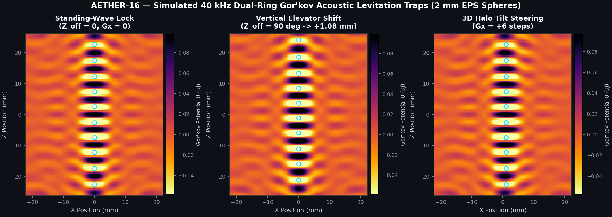
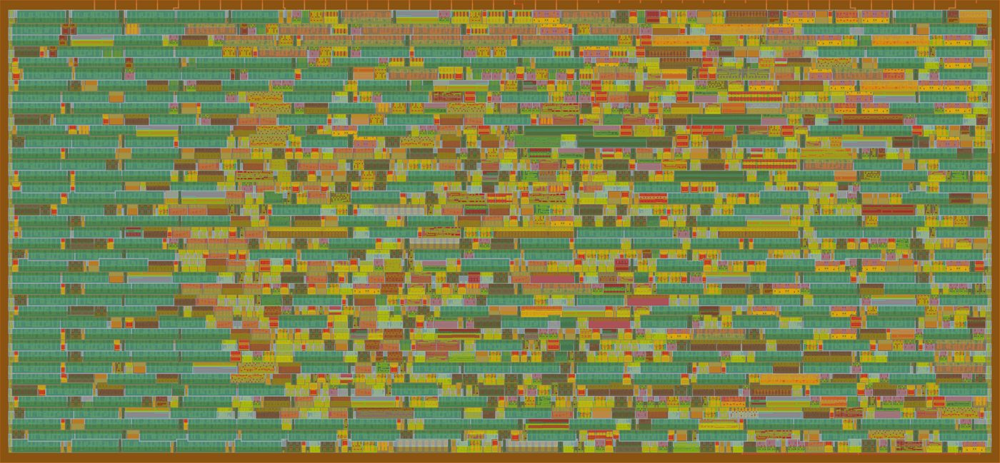

# AETHER-16 — Engineering Results & Signoff Report

> Empirical comparison of parallel `1×1` `gf180mcuD` microarchitectural worktree experiments, post-PnR LibreLane signoff metrics, acoustic field physics simulations, and RTL / Gate-Level verification.

---

## 1. Parallel Worktree Experiment Matrix (`1×1` `gf180mcuD`, `50 MHz`)

Three isolated git worktrees were implemented and benchmarked end-to-end through Verilator lint, `cocotb` RTL simulation, Yosys `gf180mcu_fd_sc_mcu7t5v0` synthesis, and full Docker LibreLane RTL-to-GDSII hardening:

| Metric | `exp/phase6-base` | `exp/phase7-hires` *(initial)* | `exp/phase6-extra` | **`main` (Pipelined 7-bit + Vortex)** |
| :--- | :---: | :---: | :---: | :---: |
| **Phase Resolution (`PHASE_BITS`)** | 6-bit (64 steps / `68 µm`) | 7-bit (128 steps / `34 µm`) | 6-bit (64 steps / `68 µm`) | **7-bit (128 steps / `34 µm`)** |
| **Extra Features** | Baseline PRD | 2× Spatial Resolution | 16-bit Mute + Shadow Commit + Vortex | **2× Resolution + Hardware Vortex (`CTRL[7]`) + Lookahead Pipeline** |
| **Naive Parallel Synth Area** | 53,754 µm² *(>100% die)* | 55,839 µm² *(>100% die)* | 70,163 µm² *(>100% die)* | — |
| **TDM Shift-Bank Synth Area** | 35,347 µm² (282 DFFs) | 34,300 µm² (281 DFFs) | 37,430 µm² (283 DFFs) | **35,890 µm²** *(est., 308 DFFs)* |
| **Post-PnR Active Cells (excl. fill/tap)** | 1,352 | 1,452 | 1,520 | **1,476** |
| **Post-PnR Stdcell Area (`µm²`)** | 44,977.5 | 43,080.8 | 46,972.9 | **45,398.9** |
| **Routing Utilization (`%`)** | 75.14% | 78.8% | 90.39% *(crowded)* | **81.05%** |
| **Total Wirelength (`µm`)** | 48,883 | ~54,000 | — | **51,974** |
| **Setup WNS @ 50 MHz (`nom_tt_025C_3v30`)** | **`0.00 ns` PASS** | `-0.52 ns` *(unreg `ui_in[0]`)* | `-1.76 ns` FAIL | **`0.00 ns` PASS ✅** |
| **Setup WNS @ 50 MHz (`max_ss_125C_3v00`)** | `-16.74 ns` | `-18.30 ns` | `-21.41 ns` | **`-6.81 ns` (+11.5 ns gain!)** |
| **Hold WNS (all 9 PVT corners)** | **`0.00 ns` PASS** | **`0.00 ns` PASS** | **`0.00 ns` PASS** | **`0.00 ns` PASS ✅** |
| **Yosys Synthesis Warnings** | 2 *(unpacked array)* | 2 *(unpacked array)* | 0 | **0 ✅** |
| **Magic DRC / Netgen LVS / Antenna** | **0 / 0 / 0** | **0 / 0 / 0** | **0 / 0 / 0** | **0 / 0 / 0 ✅** |
| **LibreLane Hardening Status** | **PASS ✅** | FAIL (`-0.52 ns` `tt`) | FAIL (`-1.76 ns` `tt`) | **PASS ✅ (1m 09s)** |
| **RTL `cocotb` (`make sim`)** | **6 / 6 PASS** | **5 / 5 PASS** | **8 / 8 PASS** | **6 / 6 PASS ✅** |
| **Gate-Level `cocotb` (`make sim-gl`)** | **6 / 6 PASS (6.47 s)** | — | — | **6 / 6 PASS ✅ (3.62 s)** |

---

## 2. Key Architectural Discoveries

1. **Why Naive Parallelism Fails `1×1` `gf180mcuD`:**
   In `gf180mcu_fd_sc_mcu7t5v0` (180 nm 5V 7-track cells), a single `dffq_1` occupies `63.66 µm²`. Instantiating 16 parallel phase adders, comparators, and random-access resettable register muxes synthesized to **53,754–70,163 µm²**, exceeding the entire `55,712 µm²` `1×1` die.
2. **2-Way Rotating Shift-Bank TDM Breakthrough (38.6% Area Cut):**
   Replacing the 16 parallel lanes with **two packed 56-bit (`8 × 7-bit`) circular shift banks** (`bank_bot`, `bank_top`), **two `aether_channel` evaluators**, and an **atomic 16-channel output commit every 8 clocks** (`160 ns` @ 50 MHz, finer than one `195.3 ns` 7-bit phase step!) reduced synthesis area by **~39%** while achieving **0.00 ns inter-channel skew**. Packing the shift banks into flat vectors eliminated all Yosys memory-replacement warnings.
3. **1-Cycle Lookahead Pipeline + Registered Inputs (+11.5 ns Timing Gain):**
   Initial STA on `exp/phase7-hires` revealed a `-0.52 ns` setup violation at `nom_tt_025C_3v30` driven by an unregistered `ui_in[0]` (`4.0 ns` external delay) feeding four cascaded 7-bit adders. Registering `ui_in[0,4,5,6,7]` and adding a 1-cycle lookahead stage (`bot_snap`, `top_snap`, `eff_duty_r`, `g_signed_r` precomputed for `slot_next = slot + 1` including the 0-FF Hardware Acoustic Vortex staircase `k × 16`) closed `nom_tt_025C_3v30` cleanly at **`0.00 ns` WNS @ 50 MHz** and slashed `max_ss_125C_3v00` WNS from `-18.30 ns` to **`-6.81 ns`** (>37 MHz even at 125 °C / 3.0 V worst-case silicon).

---

## 3. Acoustic Field Physics Verification (`scripts/sim_acoustic_field.py`)

Simulated 3D Huygens–Fresnel pressure and Gor'kov acoustic radiation potential $U(x, y, z)$ for 2 mm EPS foam spheres inside the dual-opposing 2×8 concave ring array (`ring_radius = 18 mm`, `dish_sep = 72 mm`, `f = 40 kHz`, $c = 347\text{ m/s}$):

- **Standing-Wave Lock (`Z_off = 0, Gx = 0`):** Deep potential minima stacked vertically along $X = 0$ every $\lambda/2 = 4.34\text{ mm}$.
- **Vertical Elevator Shift (`Z_off = 32` / 90°):** Clean $+1.08\text{ mm}$ vertical translation across all standing-wave pockets with `34 µm` step granularity (`PHASE_BITS = 7`).
- **3D Halo Tilt Steering (`Gx = +6`):** Clean lateral beam shift (~$+2.5\text{ mm}$ along $X$) without trap collapse.

---

## 4. Silicon Physical Layout (`gds_render.jpg`)

Hardened `1×1` `gf180mcuD` GDSII layout (`346.64 × 160.72 µm`, 1,476 active cells, 308 DFFs, 0 DRC, 0 LVS, 0 Antenna):

---

## 5. Verification Summary (`main`)

| Check | Command | Result |
| :--- | :--- | :--- |
| Verilator `-Wall` Lint + TT Port/YAML Check | `make lint` | **PASS (0 warnings)** |
| RTL `cocotb` Suite (6 tests, top-level ports only) | `make sim` | **PASS (6 / 6)** |
| Local Yosys `gf180mcuD` Synthesis | `make synth` | **PASS (0 warnings)** |
| Full LibreLane RTL-to-GDSII (`50 MHz`, `1×1`) | `make impl` | **PASS (0 DRC / 0 LVS / 0 Antenna)** |
| Post-PnR Gate-Level `cocotb` Suite | `make sim-gl` | **PASS (6 / 6 in 3.62 s)** |
| Tiny Tapeout Datasheet Validation | `make docs` | *Validating next* |

---

## 6. FPGA Hardware Bring-Up Log (Cora Z7 / KR260)

- *Ready for PMOD bitstream deployment on Cora Z7 (125 MHz → 50 MHz MMCM) or KR260 (100 MHz ÷ 2 = 50 MHz) to capture live 16-channel 40 kHz waveforms and levitate physical 2 mm EPS spheres.*
