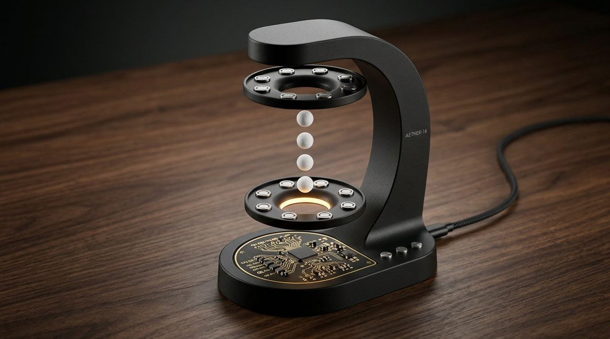
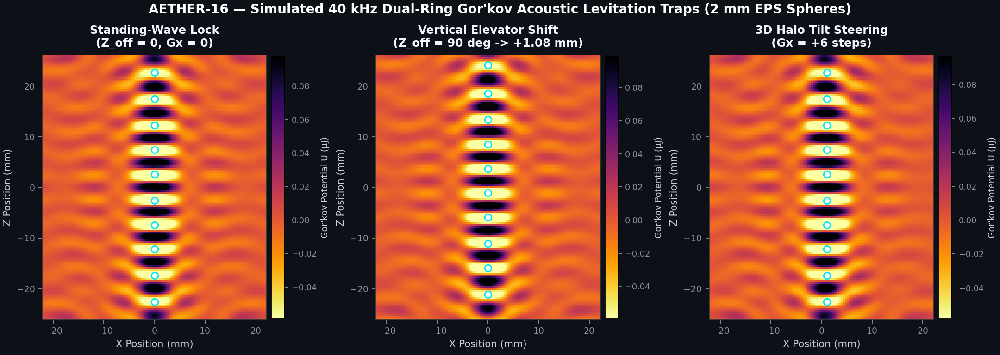
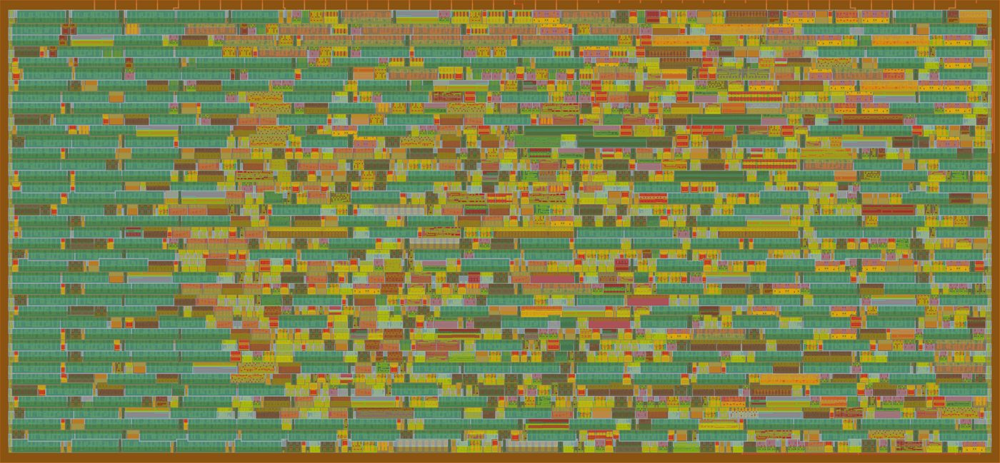

<!---

This file is used to generate your project datasheet. Please fill in the information below and delete any unused
sections.

You can also include images in this folder and reference them in the markdown. Each image must be less than
512 kb in size, and the combined size of all images must be less than 1 MB.
-->

## How it works

**AETHER-16** (`tt_um_ayushmanmalla_top`) is a pure-silicon **16-channel 40 kHz ultrasonic phased-array acoustic levitator controller** designed for a single `1×1` `gf180mcuD` Tiny Tapeout tile at `50 MHz`. It drives 16 phase-locked, glitch-free ultrasonic channels (`uo_out[7:0]` for the Bottom 8-transducer ring and `uio_out[7:0]` for the Top 8-transducer ring, `uio_oe = 8'hFF`) with **7-bit (128-step, `2.8125°` / `34 µm`) phase resolution**, enabling real 1–3 mm objects (EPS foam spheres or micro-droplets) to be suspended and smoothly animated in mid-air with zero microcontroller required.

### Silicon Architecture
To fit 16 independent 7-bit phase channels plus a 20-bit tunable NCO, SPI Mode 0 slave, 3D ring steering engine, hardware acoustic vortex generator, and standalone kinetic art FSM into a single `1×1` 180 nm tile (~81% utilization, 308 DFFs, 0 DRC/LVS/Antenna errors), AETHER-16 uses a **pipelined 2-way rotating shift-bank evaluator**:

- **20-bit Tunable Carrier NCO (`aether_nco.v`):** Default `FREQ_WORD = 12'h347` (`839`) generates `40,006.6 Hz` at `50 MHz` (and exact `40,006.6 Hz` at `25 MHz` when `CLK_DIV2 = 1`), tunable in ~48 Hz steps across ~30–50 kHz to lock onto physical piezo resonance.
- **2×8 Packed Circular Shift Banks (`bank_bot`, `bank_top`):** Store 16 independent 7-bit `CH_BASE_PHASE[0..15]` calibration/hologram registers with an 8-cycle reset scrubber for X-free Gate-Level operation.
- **1-Cycle Lookahead 3D Ring Combiner:** Evaluates 1 bottom + 1 top channel per clock and commits all 16 outputs simultaneously on `slot == 0` (`160 ns` frame @ 50 MHz < `195.3 ns` 7-bit step → **0.00 ns inter-channel skew**). Supports atomic `Z_OFFSET` elevator translation, multiplier-free 45° symmetric ring `GRAD_X` / `GRAD_Y` 3D beam steering, `top_invert` (180°), and **Hardware Acoustic Vortex Mode** (`CTRL_REG[7] = 1`, adding exact `k × 16` helical phase staircase `0..315°` across each ring).
- **Duty-Cycle Power Scaling & Parametric AM (`aether_channel.v`):** Clamped `0..50%` duty cycle scales 40 kHz acoustic pressure smoothly via $\sin(\pi D)$ with differential `TC4428A` drivers; `SOFT_PWR` (`ui_in[4]`) halves duty for gentle bead capture, and `AM_MOD_IN` (`ui_in[6]`) modulates duty depth (0/25/50/75%) for parametric audio or trap pulsing.
- **Standalone Kinetic Art Engine (`aether_art_fsm.v`):** When `MODE_SEL = 0` (`ui_in[0]`), runs completely MCU-free with 4 selectable patterns (`ui_in[4:3]`):
  - `00` — **Static Lock + Manual Jog** (`BTN_UP`/`BTN_DOWN` smoothly glide beads vertically)
  - `01` — **Zen Breathing** (smooth hardware triangle vertical oscillation `0..32` steps)
  - `10` — **3D Halo Orbit** (4-quadrant quadrature triangle waves `±12` on `Gx`/`Gy`)
  - `11` — **Continuous Elevator** (unbounded modulo-128 vertical conveyor)
- **Clock-Domain-Safe SPI Mode 0 Slave (`aether_spi.v`):** When `MODE_SEL = 1`, accepts 16-bit MSB-first frames `{guard=1'b1, 2'b00, addr[4:0], data[7:0]}` across registers `0x00..0x17` (`CH_BASE_PHASE[0..15]`, `FREQ_WORD_LO/HI`, `DUTY_CYCLE`, `Z_OFFSET`, `GRAD_X`, `GRAD_Y`, `CTRL_REG`, `SOFT_RESET = 0xA5`).

## How to test

1. **RTL and Gate-Level Verification (cocotb):**
   Run `make sim` (RTL) or `make sim-gl` (post-PnR Gate-Level netlist). The 6-test suite (`test/test.py`) verifies:
   - Default `40,006.6 Hz` carrier at `50 MHz`, `CLK_DIV2 = 1` at `25 MHz`, `uio_oe = 0xFF`, and hardware `ENABLE = 0` safety mute.
   - Full 7-bit (128-step) independent phase programming across all 16 channels via SPI Mode 0 + guard-bit rejection.
   - `FREQ_WORD` tuning, `DUTY_CYCLE` clamping, `SOFT_PWR`, 4-level `AM_MOD_IN`, `spi_out_en` mute, and `SOFT_RESET (0xA5)`.
   - Atomic 3D steering (`Z_OFFSET`, `top_invert`, signed 6-bit `GRAD_X`/`GRAD_Y` across 45° ring symmetry).
   - All 4 Standalone Kinetic Art modes (`00`..`11`) using the fast prescaler tap (`art_speed = 2'b11`).
   - Hardware Acoustic Vortex staircase (`CTRL_REG[7] = 1`) and opposing bottle trap (`CTRL_REG = 0xC5`).

2. **Day-1 Hardware Bring-Up on Stock Tiny Tapeout Demo Board:**
   Set `ui_in = 8'b0010_0000` (`MODE_SEL = 0`, `ENABLE = 1`, `PAT = 00`) and lower the Demo Board RP2040 clock to **`1 kHz`**: the 40 kHz carrier scales linearly down to **`0.8 Hz`**, allowing visual verification of all 16 channels and phase shifts directly on LEDs or a logic analyzer before attaching transducers.

## External hardware

- **Dual-Opposing 2×8 Concave Ultrasonic Array:** 16× 10 mm 40 kHz open-face transducers (`MA40S4S` or `TCT40-10T`) mounted in two opposing 8-element concave 3D-printed rings (~55 mm focal radius, ~72 mm vertical gap, open ~16 mm center aperture for an uplight LED).
- **24 Vpp Differential Driver Stage:** 16× `TC4428A` (SOIC-8: 1 inverting + 1 non-inverting MOSFET driver per IC). Each single 3.3 V ASIC output pin drives both inputs of one `TC4428A` powered from a clean **12 V USB-C PD (`CH224K`)** rail, producing **24 Vpp** across each transducer (4× the acoustic force of a 12 V half-bridge).
- **Controls / Optional Host:** Tactile switches for `MODE_SEL`, `PAT[1:0]`, `BTN_UP`/`BTN_DOWN`, and `ENABLE`, plus an optional 4-pin SPI header for external choreography (RP2040/ESP32/FPGA).
